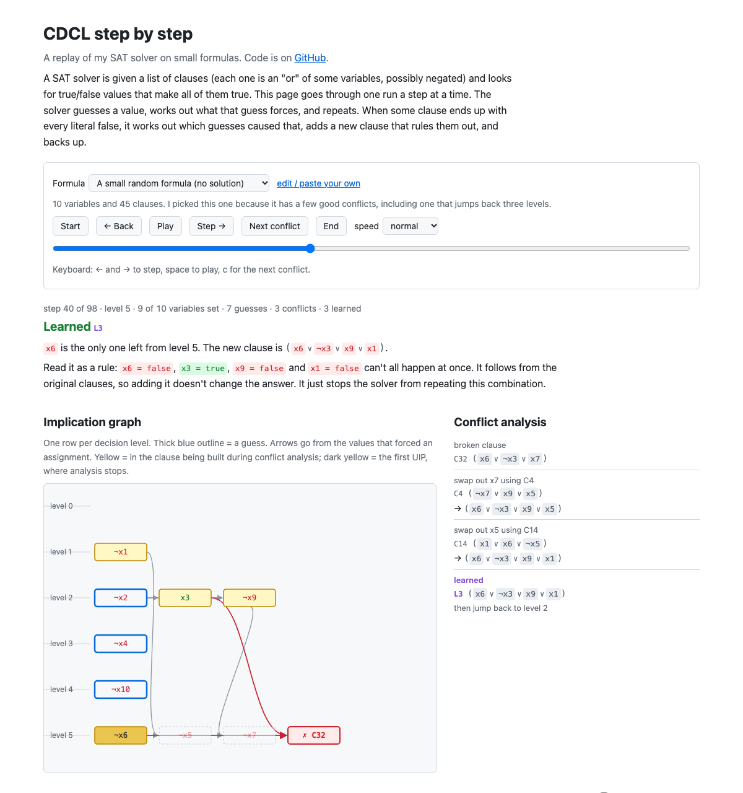
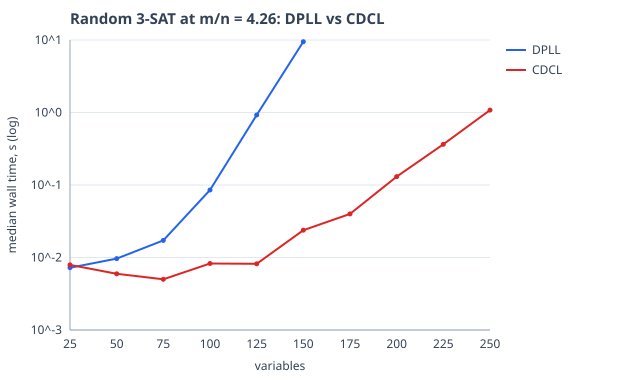
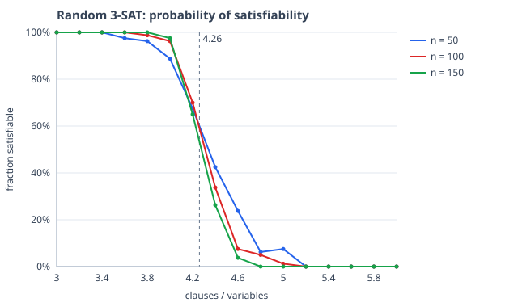
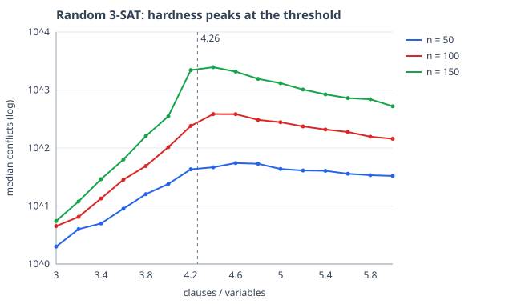
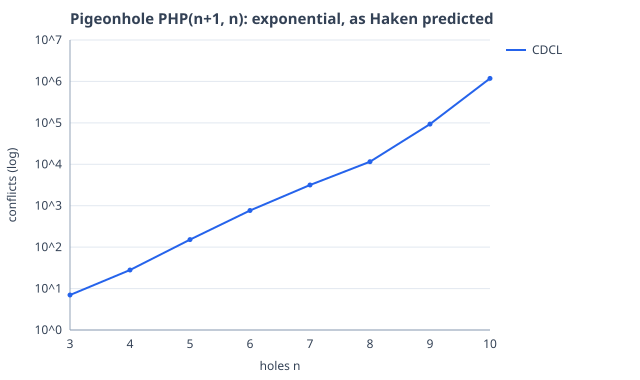

# logic-lab

A SAT solver I wrote from scratch in C++, a page that lets you watch it work, and a few
experiments I ran with it.

I got into CS through a discrete math class. SAT is where a lot of that class turns into
running code: propositional logic, proofs by resolution, the pigeonhole principle, graph
coloring. This project is me following that thread.

**[Watch the solver step by step →](https://mamoonrkhan.github.io/logic-lab/)**

[](https://mamoonrkhan.github.io/logic-lab/)

## The short version (no math needed)

Imagine planning a party where your friends come with conditions. *Alice or Bob has to come. If Bob comes,
Dave comes too. Frank, Dave and Eve can't all come.* Is there a guest list that follows every rule?

That's a **SAT problem**: a set of yes/no questions ("does Alice come?") plus rules about them, and you're
looking for answers that follow every rule at once. With six friends you could work it out on paper. Real
problems like this can have millions of yes/no questions:
- "Is this wire on?", when checking a computer chip for bugs before it's manufactured
- "Is this class in room 4 at 9am?", when building a school timetable
- "Should this version of the package be installed?", when your computer installs software

A program that solves these is called a **SAT solver**. This repo is one I built from scratch.

It works roughly the way you'd solve the party puzzle yourself:

1. **Guess** an answer to one of the questions ("say Alice stays home").
2. **Follow the rules** to see what that guess forces ("then Bob has to come, so Dave has to come").
3. If a rule gets **broken**, work out which guesses caused it, write down a new rule so the same mistake
   can't happen again, and **back up**.
4. Repeat until every rule is followed, or until it's clear that no answer can work.

Step 3 is the clever part. Older solvers just undo the last guess and try the other option, which can take
forever on big problems. Learning a new rule from every mistake is what lets modern solvers handle millions
of questions.

What's in the project:
- the solver, written in C++
- a [web page](https://mamoonrkhan.github.io/logic-lab/) that animates it, starting with the party as a
  picture story
- tools that turn puzzles like Sudoku into yes/no rules for the solver
- experiments measuring how fast it is, including puzzles that are famously hard for every solver like it
- tests that check every answer, including a separate program that double-checks the solver whenever it says
  "this is impossible"

If you just want to see it work, open the page and click through the party story. The rest of this README
is the technical version.

### Words you'll see below

- **variable**: one yes/no question, like "does Alice come?"
- **clause**: one rule, written as options joined by "or" ("Alice comes or Bob comes")
- **satisfiable (SAT)** / **unsatisfiable (UNSAT)**: some set of answers follows every rule / no set of answers does
- **CDCL** (conflict-driven clause learning): the guess, follow, learn and back up method described above
- **DPLL**: the older method that guesses and backs up but doesn't learn
- **conflict**: a moment when some rule can't be followed anymore
- **learned clause**: a new rule the solver works out from a conflict
- **proof**: a record of the solver's reasoning that another program can check, so you don't have to trust the solver

## What SAT is, more precisely

You get a formula made of variables that can be true or false, written as a list of
clauses. Each clause is a few things joined by "or", for example `x1 or not x2 or x3`.
The question is whether some true/false assignment makes every clause true at once.

That sounds like a toy problem, but a huge number of other problems can be translated
into it: Sudoku, scheduling, graph coloring, checking that a circuit is correct, and
working out which package versions are compatible. So a fast SAT solver ends up being a
general-purpose problem solver. It's also the first problem ever proven NP-complete, so
nobody knows a way to solve it quickly in every case. Real solvers still handle
formulas with millions of variables, and figuring out how was the fun part.

## What's in here

- **`src/`**: the solver. It uses CDCL (conflict-driven clause learning), the same basic
  design as MiniSat. When it can't find a solution, it can write out a proof that
  there isn't one.
- **`docs/`**: the visualizer above, plus charts. It runs a small JavaScript copy of
  the solver.
- **`tools/`**: scripts that turn puzzles into SAT and decode the answer:
  Sudoku, N-queens, the pigeonhole principle, and graph coloring. There's also a
  standalone proof checker.
- **`tests/`**: tests that throw thousands of random formulas at the solver and
  compare its answers against a brute-force solver and a simpler DPLL solver.
- **`bench/`**: the experiments below.

## Running it

You need a C++17 compiler and Python 3. Node.js is only needed for the visualizer tests.

```sh
make
./build/logiclab examples/textbook.cnf

python3 tools/sudoku.py               # solves a famously hard Sudoku
python3 tools/nqueens.py 12
python3 tools/coloring.py petersen    # finds the chromatic number, with proof

make test       # the main test suite
make test-viz   # checks the visualizer's solver against the C++ one
make bench      # reruns the experiments (takes 30-60 minutes)
```

The solver reads the standard DIMACS file format, so it also works on files from the
[SAT Competition](https://satcompetition.github.io/). Run `./build/logiclab --help` to
see the options.

## How the solver works

It keeps repeating four things:

1. **Guess.** Pick a variable that isn't set and give it a value.
2. **Follow the consequences.** If a clause has every literal false except one, that
   last one has to be true. Setting it can force others, and so on.
3. **When something breaks, figure out why.** Eventually some clause can't be
   satisfied anymore. The solver traces back through the chain of "this forced that"
   to the guesses that caused it, and turns that into a new clause. That new clause
   rules out the bad combination for good.
4. **Jump back.** Undo the guesses that caused the problem, *and* any guesses that
   had nothing to do with it. Older algorithms only back up one guess at a time.

Step 3 is resolution, the proof rule from logic class. Every clause the solver learns
is a resolution step, so when it says "no solution", it has really built a proof. With
`--proof=FILE` it writes that proof out, and `tools/drat_check.py` checks it without
trusting the solver at all.

The visualizer shows all of this happening on small examples. It's probably easier to
understand there than from this description.

## What I found

These experiments are in [bench/](bench/). Full numbers are in
[bench/RESULTS.md](bench/RESULTS.md).

**Learning makes a huge difference.** I ran the full solver and a plain backtracking
solver (DPLL) on the same random formulas. At 150 variables, DPLL takes about 9 seconds
per formula and the full solver takes 24 ms. DPLL stops finishing at all around 175
variables. The full solver gets to 250 in about a second each.



**Random formulas have a "phase transition".** Make random 3-SAT formulas with
different numbers of clauses per variable. With few clauses per variable they almost
always have a solution, and with many they almost never do. The switch happens around
4.26, and it gets sharper as the formulas get bigger. The hardest formulas sit right at
the switch point: there are about 450× more conflicts there than at 3 clauses per
variable. Nobody has proven exactly where
the threshold is. It's still an open problem.




**The pigeonhole principle is a wall.** "You can't fit n+1 pigeons into n holes" is
something you can prove by hand in one line. Written as a SAT formula, though, Haken
proved in 1985 that any resolution proof of it needs exponentially many steps. Since
this solver's proofs are resolution proofs, that's a hard limit on how fast it can be,
and the measurements show it. Every extra hole multiplies the work by about 4 to 13.
11 pigeons in 10 holes takes 53 seconds, and 12 in 11 didn't finish in 10 minutes.



**Not every trick helps.** I turned each feature off one at a time:

| | random formulas (n=200) | pigeonhole (10 into 9) | Mycielski graph, 5 colors |
|---|---:|---:|---:|
| everything on | 1.6 s | 1.8 s | 3.8 s |
| Luby restarts instead of Glucose | 2.0 s | 4.0 s | 7.7 s |
| no restarts at all | 3.4 s | 0.7 s | 1.9 s |
| no clause shrinking | 1.9 s | 3.9 s | 8.6 s |
| no remembered phases | 1.8 s | 1.8 s | 4.8 s |
| never forget learned clauses | 3.0 s | 2.9 s | 12.8 s |

**Smarter restarts.** My first version restarted on a fixed schedule (the Luby
sequence), and on the pigeonhole and Mycielski problems that made it 4 to 6 times slower
than not restarting at all. So I switched to the approach from the Glucose solver. Every
learned clause gets a score, its LBD: the number of different guesses it depends on,
where lower is better. The solver keeps the average score of the last 50 learned
clauses. If that recent average gets clearly worse than the overall average, the
current line of search isn't going anywhere, and it restarts. It also skips a planned
restart when it has unusually many variables set, because it might be close to a
solution.

Compared with Luby, that's about 2 times faster on the pigeonhole and Mycielski
problems and about 1.3 times faster on random formulas. Not restarting at all is still fastest on pigeonhole and
Mycielski. Those formulas are crafted to be hard in a very uniform way, so throwing away
progress never pays off. I also tried 36 real-world instances from
[SATLIB](https://www.cs.ubc.ca/~hoos/SATLIB/): hardware model checking, circuit testing
and planning problems. They turned out to be too easy for this solver to show much
difference; all of them take under 6 seconds with any policy. Full numbers are in
[bench/RESULTS.md](bench/RESULTS.md).

## How I know the answers are right

- Every "has a solution" answer is checked by plugging the solution back into the
  formula.
- Every "no solution" answer in the tests comes with a proof, and a separate
  100-line checker verifies it.
- The tests compare the solver against brute force and DPLL on thousands of random
  formulas, with each feature turned on and off.
- CI runs everything on Linux and macOS, and again with AddressSanitizer and UBSan
  turned on to catch memory bugs.

## Things I read

- Marques-Silva and Sakallah, *GRASP* (1999): where clause learning comes from
- Moskewicz et al., *Chaff* (2001): watched literals and VSIDS
- Eén and Sörensson, *An Extensible SAT-solver* (2003): MiniSat
- Audemard and Simon, *Glucose* (2009): judging which learned clauses to keep
- Haken, *The Intractability of Resolution* (1985): the pigeonhole result
- Mitchell, Selman and Levesque, *Hard and Easy Distributions of SAT Problems* (1992)
- Biere, Heule, van Maaren and Walsh (eds.), *Handbook of Satisfiability* (2021)

MIT license.
