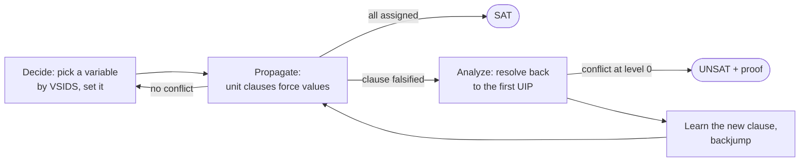

# logic-lab

A conflict-driven clause learning (CDCL) SAT solver written from scratch in C++17. It
produces machine-checkable proofs when it answers "unsatisfiable", and it comes with a
set of experiments that test results from discrete math and complexity theory against
real measurements.

```
$ python3 tools/coloring.py grotzsch
Grötzsch graph: 11 vertices, 20 edges
  k=1: UNSAT  no 1-coloring (1 conflicts, proof verified)
  k=2: UNSAT  no 2-coloring (1 conflicts, proof verified)
  k=3: UNSAT  no 3-coloring (8 conflicts, proof verified)
  k=4: SAT    found a 4-coloring (0 conflicts)
  chi = 4
```

That output is a proof that the Grötzsch graph has chromatic number 4. The 4-coloring
is checked directly. The claim that no 3-coloring exists comes with a DRAT proof, and
an independent checker verifies it without trusting the solver.

## Why SAT?

The question is: given a propositional formula, is there an assignment of true/false
to its variables that makes it true? It is the first problem ever proven NP-complete
(Cook–Levin, 1971), so in the worst case every known algorithm takes exponential time.
Yet modern solvers routinely handle industrial formulas with millions of variables,
and they are used in hardware verification, package managers, compilers and
cryptanalysis. This project is about understanding why that works, and where it stops
working.

## Features

**Solver** ([src/cdcl.cpp](src/cdcl.cpp), about 500 lines)
- Two-watched-literal unit propagation with blocking literals
- First-UIP conflict analysis, non-chronological backjumping and clause learning
- Learned-clause minimization
- VSIDS branching heuristic on a binary heap, with phase saving
- Luby-sequence restarts
- Learned-clause database reduction driven by LBD ("glue") and activity
- All clauses stored in one contiguous arena, compacted during garbage collection
- DRAT proof output for every UNSAT answer

**Baselines**, kept as test oracles: truth-table brute force and classic DPLL
([src/reference.cpp](src/reference.cpp)).

**Encoders**, each turning a problem into CNF: Sudoku, N-Queens, the pigeonhole
principle, and graph coloring / chromatic number ([tools/](tools/)).

**Verification**
- An independent proof checker in about 100 lines of Python
  ([tools/drat_check.py](tools/drat_check.py)).
- Differential fuzzing: thousands of random formulas, each solved by CDCL, DPLL and
  brute force. All three must agree, every model is checked against the formula, and
  every UNSAT proof must verify.
- Every solver feature can be switched off, and each configuration is fuzzed on its
  own.
- CI on Linux and macOS, including a run under AddressSanitizer and UBSan.

## Quick start

Needs a C++17 compiler and Python 3.9+. There are no other dependencies.

```sh
make                 # builds build/logiclab
make test            # differential fuzzing + proof checking + encoder tests
make bench           # reruns the experiments below (30–60 minutes)

./build/logiclab --stats examples/php-8-7.cnf
./build/logiclab --proof=out.drat examples/grotzsch-3col.cnf
python3 tools/drat_check.py examples/grotzsch-3col.cnf out.drat

python3 tools/sudoku.py            # solves "the world's hardest Sudoku"
python3 tools/nqueens.py 50
python3 tools/coloring.py mycielski 5
python3 tools/pigeonhole.py --sweep 9
```

The solver reads standard [DIMACS CNF](https://jix.github.io/varisat/manual/0.2.0/formats/dimacs.html)
and writes the SAT Competition output format: an `s` status line, `v` model lines, and
exit code 10 for SAT or 20 for UNSAT. That means it can be run directly on
[SAT Competition](https://satcompetition.github.io/) benchmark files.

```
usage: logiclab [options] <file.cnf | ->
  --algo=cdcl|dpll|brute   solving algorithm (default: cdcl)
  --proof=FILE             write a DRAT proof of unsatisfiability
  --stats                  print search statistics
  --max-conflicts=N        give up after N conflicts
  --no-restarts | --no-minimize | --no-phase-saving | --no-reduce
  --reduce-interval=N      conflicts between learned-clause cleanups
```

## How CDCL works



1. **Decide.** Pick an unassigned variable and guess a value for it. VSIDS prefers
   variables that showed up in recent conflicts.
2. **Propagate.** A clause with all but one literal false forces that last literal to
   be true. The two-watched-literal scheme finds these clauses without scanning the
   whole formula, and backtracking costs nothing because the watches never need
   restoring.
3. **Analyze.** When some clause becomes all-false, work out *why*. Repeatedly
   [resolve](https://en.wikipedia.org/wiki/Resolution_(logic)) the conflicting clause
   with the clauses that forced its literals, until exactly one literal from the
   current decision level remains (the first UIP). The result is a new clause that the
   original formula logically implies.
4. **Learn and backjump.** Add that clause, then jump back to the earliest decision
   level where it forces something. That can be many levels at once, unlike DPLL's
   one-step backtracking. Because the clause stays in the formula, the solver never
   repeats that mistake.

Each learned clause is a resolution step, so a run that ends in UNSAT has in effect
built a resolution proof. Writing those clauses out gives the DRAT proof. The same
fact also sets the solver's limits, as the pigeonhole experiment below shows.

## Experiments

Full numbers are in [bench/RESULTS.md](bench/RESULTS.md). Everything can be
regenerated with `make bench`.

### 1. CDCL vs DPLL: learning is the difference


Both algorithms ran on random 3-SAT at the hardest ratio (m = 4.26n), 20 formulas per
size. DPLL's running time grows roughly 10× for every 25 variables. At n = 150 it
already misses its 10-second limit on a third of the formulas, and by n = 175 it solves
almost none. CDCL solves n = 150 in a median of **15 ms (about 450× faster)** and gets
to n = 250 before reaching DPLL's n = 150 running time. Both algorithms use the same
propagation logic. The gap comes from clause learning and backjumping.

### 2. The phase transition in random 3-SAT


These are random 3-SAT formulas with n variables and m clauses. With few clauses per
variable, almost every formula is satisfiable; with many, almost none are. The switch
is sharp, and it gets sharper as n grows. It happens near m/n ≈ 4.26, a value that has
been observed experimentally but never proven (the existence of a sharp threshold was
shown by Friedgut in 1999). The second chart shows that the *hardest* formulas sit
right at the threshold: under-constrained formulas are easy to satisfy and
over-constrained ones are quick to refute. For n = 150, median search effort peaks at
about 2,000 conflicts near the threshold, against about 5 at m/n = 3. Each point is the
median of 80 formulas.

### 3. The pigeonhole principle: a theorem that sets a speed limit


"You can't fit n+1 pigeons into n holes" takes one line to prove by hand. Encoded as
CNF, though, it is famously hard. **Haken (1985)** proved that every resolution proof
of it has exponential size, and since CDCL produces resolution proofs, that is a hard
lower bound for this solver. The measurements match: each extra hole multiplies the
conflict count by about 4–10×. PHP(11,10) takes 1.3 million conflicts (70 s), and
PHP(12,11) does not finish within 10 minutes. Getting past this needs a stronger proof
system, such as extended resolution or cutting planes. That is a theorem about proofs
limiting a real program.

### 4. Ablation: what each feature buys

Total time across each benchmark family with one feature turned off. See
[bench/RESULTS.md](bench/RESULTS.md) for conflict counts.

| configuration | random 3-SAT n=200 (×16) | PHP(10,9) | Mycielski M6, 5 colors |
|---|---:|---:|---:|
| full solver | 2.37 s | 3.86 s | 7.89 s |
| no restarts | 2.29 s | **0.65 s** | **1.92 s** |
| no clause minimization | 1.99 s | 7.22 s | 18.11 s |
| no phase saving | 2.88 s | 7.03 s | 15.51 s |
| no learned-clause deletion | 2.95 s | 18.29 s | 16.17 s |

Clause minimization, phase saving and clause deletion each make the solver about 2–5×
faster on the structured UNSAT instances. Restarts are the surprise: on these two
families they *hurt* by 4–6×, because restarting throws away a partial refutation
that was nearly finished. Industrial solvers deal with this using adaptive
(LBD-based, Glucose-style) restarts, which is the obvious next feature to add. On
small random formulas, none of these features matters much.

### 5. Proof checking

Every UNSAT result in the test suite, several hundred per run (including PHP(8,7) and
the chromatic-number lower bounds), is verified by the independent checker. The solver
deletes learned clauses as it goes, and the checker replays those deletions too. The
fuzzer has also run thousands of formulas under AddressSanitizer and UBSan, with
every solver configuration, without a disagreement or a memory error.

## Project layout

```
src/        the solver: DIMACS parser, CDCL, DPLL / brute-force baselines, CLI
tools/      encoders (sudoku, nqueens, coloring, pigeonhole), proof checker, helpers
tests/      differential fuzzer and regression tests
bench/      experiments; results in bench/RESULTS.md
examples/   small DIMACS files with known answers
docs/       generated charts
```

## References

- J. Marques-Silva, K. Sakallah. *GRASP: A search algorithm for propositional satisfiability.* 1999.
- M. Moskewicz et al. *Chaff: Engineering an efficient SAT solver.* DAC 2001.
- N. Eén, N. Sörensson. *An extensible SAT-solver* (MiniSat). SAT 2003.
- G. Audemard, L. Simon. *Predicting learnt clauses quality in modern SAT solvers* (Glucose). IJCAI 2009.
- A. Haken. *The intractability of resolution.* Theoretical Computer Science, 1985.
- D. Mitchell, B. Selman, H. Levesque. *Hard and easy distributions of SAT problems.* AAAI 1992.
- N. Wetzler, M. Heule, W. Hunt. *DRAT-trim: Efficient checking and trimming using expressive clausal proofs.* SAT 2014.
- A. Biere, M. Heule, H. van Maaren, T. Walsh (eds.). *Handbook of Satisfiability*, 2nd ed., 2021.

## License

MIT
