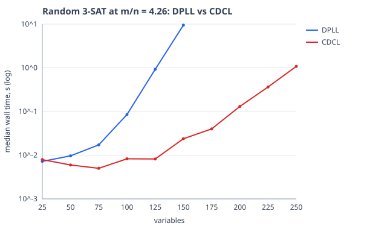

# Benchmark results

Generated by `make bench` on Apple M2 (Darwin), 2026-11-25.

## Phase transition

80 random 3-SAT formulas per point.

| n | m/n | % SAT | median conflicts |
|---:|---:|---:|---:|
| 50 | 3.0 | 100% | 2 |
| 50 | 3.6 | 98% | 9 |
| 50 | 4.0 | 89% | 24 |
| 50 | 4.2 | 68% | 43 |
| 50 | 4.4 | 42% | 46.5 |
| 50 | 4.8 | 6% | 53.5 |
| 50 | 5.4 | 0% | 40.5 |
| 50 | 6.0 | 0% | 33 |
| 100 | 3.0 | 100% | 4.5 |
| 100 | 3.6 | 100% | 28.5 |
| 100 | 4.0 | 96% | 103.5 |
| 100 | 4.2 | 70% | 240 |
| 100 | 4.4 | 34% | 385 |
| 100 | 4.8 | 5% | 306 |
| 100 | 5.4 | 0% | 208 |
| 100 | 6.0 | 0% | 144 |
| 150 | 3.0 | 100% | 5.5 |
| 150 | 3.6 | 100% | 63.5 |
| 150 | 4.0 | 98% | 352.5 |
| 150 | 4.2 | 65% | 2206 |
| 150 | 4.4 | 26% | 2473.5 |
| 150 | 4.8 | 0% | 1555 |
| 150 | 5.4 | 0% | 839 |
| 150 | 6.0 | 0% | 525.5 |

## DPLL vs CDCL

20 random 3-SAT formulas per size at the threshold (m = 4.26n), limit 10s (DPLL) / 60s (CDCL) per run, median wall time including process startup.

| n | DPLL | CDCL |
|---:|---:|---:|
| 25 | 7.2 ms | 7.9 ms |
| 50 | 9.7 ms | 6.0 ms |
| 75 | 17.2 ms | 5.0 ms |
| 100 | 85.3 ms | 8.3 ms |
| 125 | 924.6 ms | 8.2 ms |
| 150 | 9470.4 ms (10/20 solved) | 23.8 ms |
| 175 | timeout (3/20 solved) | 40.0 ms |
| 200 | — | 130.4 ms |
| 225 | — | 364.5 ms |
| 250 | — | 1079.0 ms |

## Pigeonhole principle

PHP(n+1, n) is unsatisfiable for every n, but every resolution refutation has exponential size (Haken 1985). CDCL can't escape that lower bound.

| holes | vars | clauses | conflicts | time | ratio |
|---:|---:|---:|---:|---:|---:|
| 3 | 12 | 22 | 7 | 0.00s |  |
| 4 | 20 | 45 | 28 | 0.00s | ×4.0 |
| 5 | 30 | 81 | 152 | 0.00s | ×5.4 |
| 6 | 42 | 133 | 766 | 0.00s | ×5.0 |
| 7 | 56 | 204 | 3155 | 0.02s | ×4.1 |
| 8 | 72 | 297 | 11546 | 0.11s | ×3.7 |
| 9 | 90 | 415 | 93330 | 1.69s | ×8.1 |
| 10 | 110 | 561 | 1182452 | 53.20s | ×12.7 |
| 11 | 132 | 738 | TIMEOUT | 600.00s |  |

## Ablation

Total wall time summed over each family's instances (60s limit per instance; conflicts in parentheses).

| configuration | random 3-SAT n=200 (x16) | pigeonhole PHP(10,9) | 7x7 queens graph, 7 colors | Mycielski M6, 5 colors |
|---|---:|---:|---:|---:|
| full solver | 1.62s (190,705) | 1.75s (93,330) | 0.01s (99) | 3.77s (184,970) |
| Luby restarts instead | 2.04s (220,212) | 4.01s (164,842) | 0.01s (99) | 7.65s (299,162) |
| no restarts | 3.43s (235,660) | 0.73s (50,922) | 0.01s (99) | 1.87s (109,224) |
| no minimization | 1.90s (208,770) | 3.89s (178,320) | 0.01s (106) | 8.62s (271,337) |
| no phase saving | 1.81s (200,511) | 1.81s (80,230) | 0.01s (175) | 4.84s (180,748) |
| no clause deletion | 2.97s (184,654) | 2.93s (51,948) | 0.01s (99) | 12.77s (135,550) |

## Restart policies

Total wall time per family (300s limit per instance; a timeout counts as the full limit). SATLIB instances: https://www.cs.ubc.ca/~hoos/SATLIB/

| family | Glucose | Luby | none |
|---|---:|---:|---:|
| random 3-SAT n=250 (×16) | 29.19s | 38.45s | 29.72s |
| pigeonhole PHP(10,9) | 2.61s | 4.05s | 0.66s |
| Mycielski M6, 5 colors | 3.89s | 8.42s | 1.83s |
| bounded model checking (bmc) (×13) | 5.36s | 5.94s | 4.82s |
| circuit fault analysis (bf) (×4) | 0.05s | 0.04s | 0.04s |
| circuit fault analysis (ssa) (×8) | 0.08s | 0.11s | 0.11s |
| planning: logistics (×4) | 0.08s | 0.07s | 0.07s |
| planning: blocks world (×7) | 0.27s | 0.34s | 0.29s |
