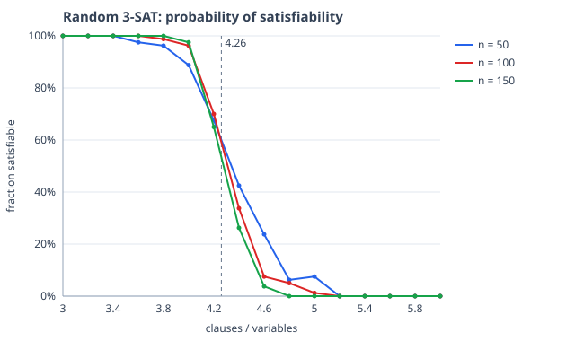
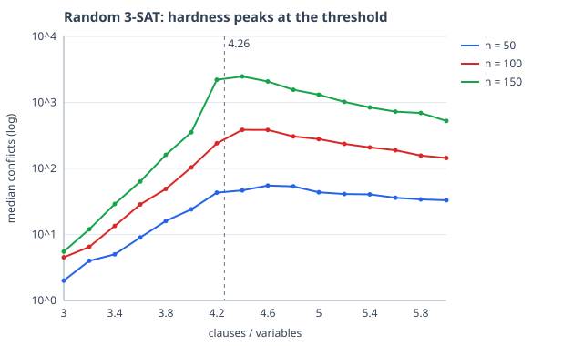
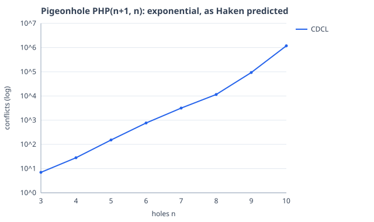

# Benchmark results

Generated by `make bench` on Apple M2 (Darwin), 2026-11-25.

## Phase transition

80 random 3-SAT formulas per point.

| n | m/n | % SAT | median conflicts |
|---:|---:|---:|---:|
| 50 | 3.0 | 100% | 2 |
| 50 | 3.6 | 98% | 9 |
| 50 | 4.0 | 89% | 24 |
| 50 | 4.2 | 68% | 43 |
| 50 | 4.4 | 42% | 46.5 |
| 50 | 4.8 | 6% | 53.5 |
| 50 | 5.4 | 0% | 40.5 |
| 50 | 6.0 | 0% | 33 |
| 100 | 3.0 | 100% | 4.5 |
| 100 | 3.6 | 100% | 28.5 |
| 100 | 4.0 | 96% | 104 |
| 100 | 4.2 | 70% | 236 |
| 100 | 4.4 | 34% | 344.5 |
| 100 | 4.8 | 5% | 287 |
| 100 | 5.4 | 0% | 207.5 |
| 100 | 6.0 | 0% | 146 |
| 150 | 3.0 | 100% | 5.5 |
| 150 | 3.6 | 100% | 63.5 |
| 150 | 4.0 | 98% | 369 |
| 150 | 4.2 | 65% | 1706 |
| 150 | 4.4 | 26% | 2082 |
| 150 | 4.8 | 0% | 1362 |
| 150 | 5.4 | 0% | 720.5 |
| 150 | 6.0 | 0% | 473.5 |

## DPLL vs CDCL

20 random 3-SAT formulas per size at the threshold (m = 4.26n), limit 10s (DPLL) / 60s (CDCL) per run, median wall time including process startup.

| n | DPLL | CDCL |
|---:|---:|---:|
| 25 | 3.7 ms | 3.5 ms |
| 50 | 4.7 ms | 3.8 ms |
| 75 | 15.0 ms | 3.8 ms |
| 100 | 62.7 ms | 4.8 ms |
| 125 | 711.9 ms | 6.4 ms |
| 150 | 6874.3 ms (13/20 solved) | 15.4 ms |
| 175 | timeout (3/20 solved) | 35.2 ms |
| 200 | — | 101.8 ms |
| 225 | — | 467.2 ms |
| 250 | — | 2608.3 ms |

## Pigeonhole principle

PHP(n+1, n) is unsatisfiable for every n, but every resolution refutation has exponential size (Haken 1985). CDCL can't escape that lower bound.

| holes | vars | clauses | conflicts | time | ratio |
|---:|---:|---:|---:|---:|---:|
| 3 | 12 | 22 | 7 | 0.00s |  |
| 4 | 20 | 45 | 28 | 0.00s | ×4.0 |
| 5 | 30 | 81 | 155 | 0.00s | ×5.5 |
| 6 | 42 | 133 | 638 | 0.00s | ×4.1 |
| 7 | 56 | 204 | 3296 | 0.02s | ×5.2 |
| 8 | 72 | 297 | 17374 | 0.21s | ×5.3 |
| 9 | 90 | 415 | 164842 | 3.73s | ×9.5 |
| 10 | 110 | 561 | 1315496 | 70.18s | ×8.0 |
| 11 | 132 | 738 | TIMEOUT | 600.00s |  |

## Ablation

Total wall time summed over each family's instances (60s limit per instance; conflicts in parentheses).

| configuration | random 3-SAT n=200 (x16) | pigeonhole PHP(10,9) | 7x7 queens graph, 7 colors | Mycielski M6, 5 colors |
|---|---:|---:|---:|---:|
| full solver | 2.37s (220,212) | 3.86s (164,842) | 0.01s (99) | 7.89s (299,162) |
| no restarts | 2.29s (235,660) | 0.65s (50,922) | 0.01s (99) | 1.92s (109,224) |
| no minimization | 1.99s (208,579) | 7.22s (254,679) | 0.01s (466) | 18.11s (465,084) |
| no phase saving | 2.88s (205,122) | 7.03s (155,995) | 0.06s (2,936) | 15.51s (340,481) |
| no clause deletion | 2.95s (198,277) | 18.29s (117,464) | 0.01s (99) | 16.17s (146,656) |
